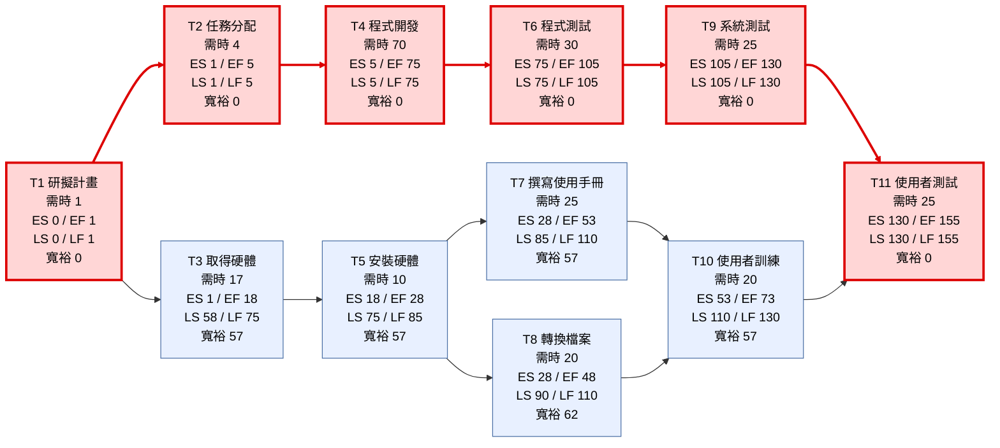
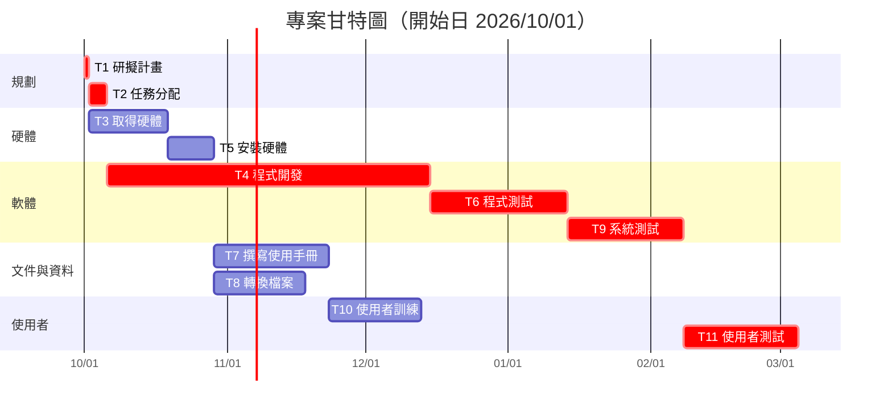

# 個人作業 2：PERT/CPM 圖、甘特圖與關鍵路徑

## 一、任務清單（圖 3-27）

| 任務 | 說明 | 需時（天） | 前置任務 |
|:---:|:---|:---:|:---:|
| 1 | 研擬計畫 | 1 | – |
| 2 | 任務分配 | 4 | 1 |
| 3 | 取得硬體 | 17 | 1 |
| 4 | 程式開發 | 70 | 2 |
| 5 | 安裝硬體 | 10 | 3 |
| 6 | 程式測試 | 30 | 4 |
| 7 | 撰寫使用手冊 | 25 | 5 |
| 8 | 轉換檔案 | 20 | 5 |
| 9 | 系統測試 | 25 | 6 |
| 10 | 使用者訓練 | 20 | 7, 8 |
| 11 | 使用者測試 | 25 | 9, 10 |

## 二、步驟 1：顯示任務及任務模式（前推 / 後推計算）

- **ES**（最早開始）= 所有前置任務 EF 的最大值
- **EF**（最早完成）= ES + 需時
- **LF**（最晚完成）= 所有後續任務 LS 的最小值
- **LS**（最晚開始）= LF − 需時
- **寬裕時間（Slack）**= LS − ES，寬裕時間為 0 者即為關鍵任務

| 任務 | 說明 | 需時 | ES | EF | LS | LF | 寬裕 | 關鍵 |
|:---:|:---|:---:|:---:|:---:|:---:|:---:|:---:|:---:|
| 1 | 研擬計畫 | 1 | 0 | 1 | 0 | 1 | 0 | ✅ |
| 2 | 任務分配 | 4 | 1 | 5 | 1 | 5 | 0 | ✅ |
| 3 | 取得硬體 | 17 | 1 | 18 | 58 | 75 | 57 | |
| 4 | 程式開發 | 70 | 5 | 75 | 5 | 75 | 0 | ✅ |
| 5 | 安裝硬體 | 10 | 18 | 28 | 75 | 85 | 57 | |
| 6 | 程式測試 | 30 | 75 | 105 | 75 | 105 | 0 | ✅ |
| 7 | 撰寫使用手冊 | 25 | 28 | 53 | 85 | 110 | 57 | |
| 8 | 轉換檔案 | 20 | 28 | 48 | 90 | 110 | 62 | |
| 9 | 系統測試 | 25 | 105 | 130 | 105 | 130 | 0 | ✅ |
| 10 | 使用者訓練 | 20 | 53 | 73 | 110 | 130 | 57 | |
| 11 | 使用者測試 | 25 | 130 | 155 | 130 | 155 | 0 | ✅ |

## 三、步驟 2：輸入開始及結束時間

假設專案開始日為 **2026/10/01**，以日曆天計算（含週末）：

| 任務 | 說明 | 需時 | 開始日期 | 結束日期 |
|:---:|:---|:---:|:---:|:---:|
| 1 | 研擬計畫 | 1 | 2026/10/01 | 2026/10/01 |
| 2 | 任務分配 | 4 | 2026/10/02 | 2026/10/05 |
| 3 | 取得硬體 | 17 | 2026/10/02 | 2026/10/18 |
| 4 | 程式開發 | 70 | 2026/10/06 | 2026/12/14 |
| 5 | 安裝硬體 | 10 | 2026/10/19 | 2026/10/28 |
| 6 | 程式測試 | 30 | 2026/12/15 | 2027/01/13 |
| 7 | 撰寫使用手冊 | 25 | 2026/10/29 | 2026/11/22 |
| 8 | 轉換檔案 | 20 | 2026/10/29 | 2026/11/17 |
| 9 | 系統測試 | 25 | 2027/01/14 | 2027/02/07 |
| 10 | 使用者訓練 | 20 | 2026/11/23 | 2026/12/12 |
| 11 | 使用者測試 | 25 | 2027/02/08 | 2027/03/04 |

## 四、(1) PERT/CPM 圖

紅色粗線為關鍵路徑。

## 五、(2) 甘特圖

紅色長條為關鍵任務。

## 六、(3) 關鍵路徑

**關鍵路徑：1 → 2 → 4 → 6 → 9 → 11**

| 路徑 | 計算 | 總天數 |
|:---|:---|:---:|
| **1 → 2 → 4 → 6 → 9 → 11** | **1 + 4 + 70 + 30 + 25 + 25** | **155** |
| 1 → 3 → 5 → 7 → 10 → 11 | 1 + 17 + 10 + 25 + 20 + 25 | 98 |
| 1 → 3 → 5 → 8 → 10 → 11 | 1 + 17 + 10 + 20 + 20 + 25 | 93 |

- 專案最短完成時間為 **155 天**（2026/10/01 ～ 2027/03/04）。
- 關鍵路徑上的任務寬裕時間皆為 0，任何一項延誤都會使整個專案延誤。
- 非關鍵任務（3、5、7、10）有 57 天寬裕時間，任務 8 有 62 天寬裕時間。
